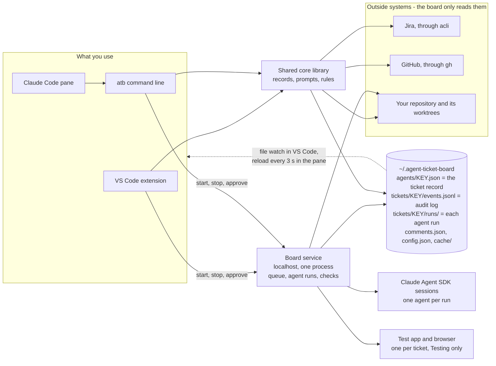
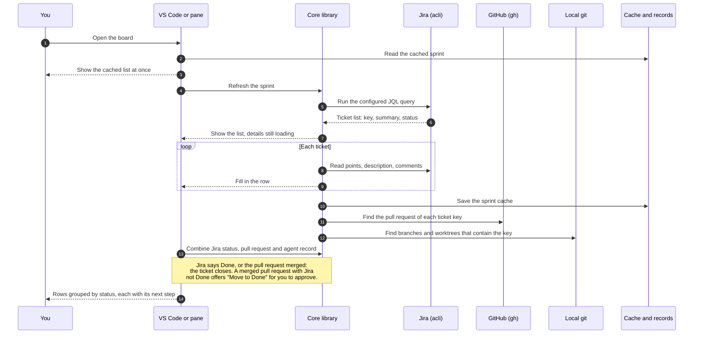
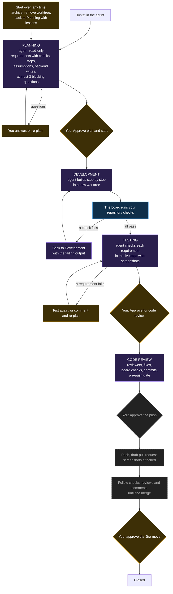
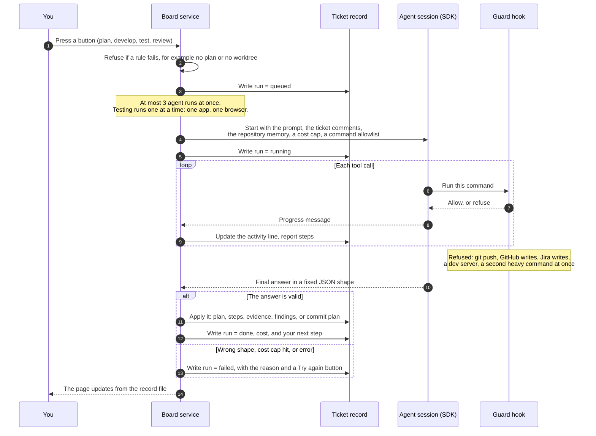
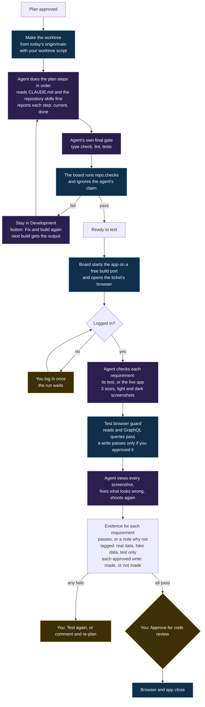
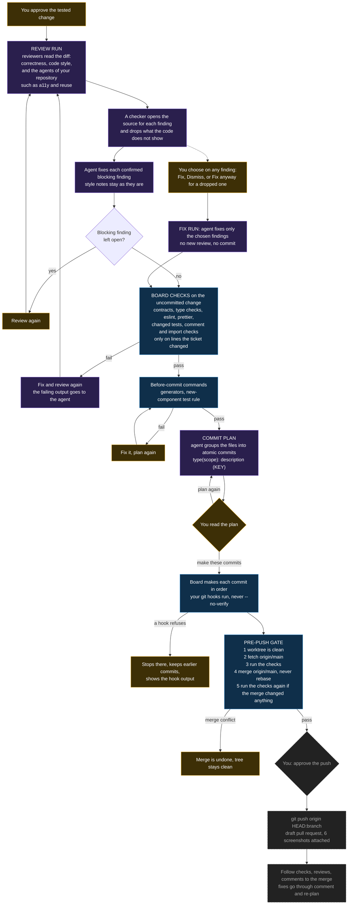
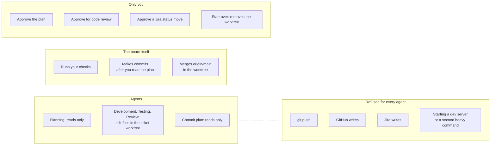

# How the board works

Seven charts show the whole system. Each chart ends with the places where you can check it: an audit event, a field of the ticket record, or a command. Nothing here needs the code.

Colour key: amber = a step that needs you. Violet = an agent works. Blue = the board runs it with no agent. Grey dashed = planned, not built yet.

## 1. The parts

Check it: `atb service` prints the service pid and the tickets with an active run. `~/.agent-ticket-board/service.json` holds its port.

## 2. How tickets arrive

Check it: `atb sprint --cached` prints the cache. A ticket with work in git but no record shows an "adopt" offer. The only Jira write is a status move that you approve (event `move` in `events.jsonl`).

## 3. The stages and who decides

Check it: the field `stage` of `agents/KEY.json` is `planning`, `development`, `testing` or `code-review`. The field `need` is the one line and the buttons you see. Moves and approvals are in the audit log: `testing.approved`, `start-over`.

## 4. The life of one agent run

Check it: every run has a folder `tickets/KEY/runs/<time>-<stage>/` with `prompt.md`, `messages.jsonl` (everything the agent did), `output.json`, `summary.json` (cost, turns) and `options.json` (the allowlist). The audit log shows `run.queued`, `run.started`, `run.done` or `run.failed`, and `tools.refused` with each refused command.

## 5. Development and Testing

Check it: `steps` in the record show each step as todo, current or done. `gate` shows the board's own check result, step by step. `evidence` has one entry for each requirement, with its screenshot paths. Screenshots are in `tickets/KEY/shots/`. Each entry also has `data`: `real`, `fake` or `none`. `writeRuns` lists each approved write with `made` and its result. A pass on fake data still lets you approve. The decision text names the fake data and the writes that were not made.

## 6. Code review, commits and the pre-push gate

Not built yet (grey): the push, the draft pull request, and the pull request tracking. Today the flow ends after the pre-push gate.

Check it: `codeReview.findings` lists each finding as `fixed`, `open` or `dropped`, with the reviewer, file and line. A finding that you chose has `decision`: `fix` or `dismiss`. A dismissed finding never blocks. Audit event: `finding`. `gate.steps` lists each check and its output. `commits.done` lists each commit and its short hash. Audit events: `verify.started`, `gate.done`, `before-commit`, `commit.made`, `commit.failed`.

## 7. What the board may write

Check it: a refused command is in the audit log as `tools.refused`. The guard rules are in `apps/claude-plugin/hooks/guards.ts`.

## Where to look when something seems wrong

| You see | Look at |
|---|---|
| A button does nothing | `atb service` for an active run. Then the last lines of `tickets/KEY/events.jsonl`. |
| A run failed | `tickets/KEY/runs/<latest>/summary.json`, then `messages.jsonl` for the last tool results. |
| The wrong next step | `need` in `agents/KEY.json`. |
| A check failed | `gate.steps` in the record. The note holds the last lines of the output. |
| An agent was blocked | `tools.refused` in the audit log. |
| Cost | `spent` in the record. Each run's `summary.json` has its own cost. |
